<div align="center">

<a href="#ai-student-learning-mentor">
  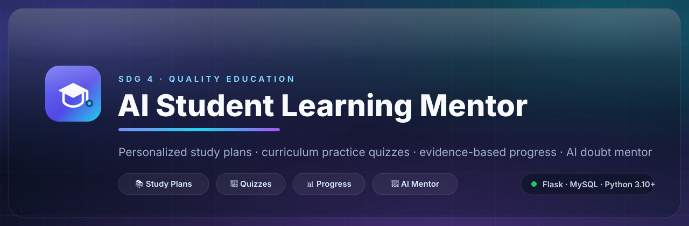
</a>

# AI Student Learning Mentor

**Your personal AI-powered learning companion - deterministic study planning, cheat-resistant practice quizzes, evidence-based progress, and syllabus-grounded AI doubt resolution.**

A full-stack academic mentorship platform built with **Python, Flask and MySQL** that turns a scattered self-study routine into a structured, measurable curriculum.

[](#-roadmap)
[](LICENSE)
[](#-testing)
[](https://www.python.org/)
[](https://flask.palletsprojects.com/)
[](https://www.mysql.com/)

[](https://github.com/flawsom/AI-Student-Learning-Mentor/stargazers)
[](https://github.com/flawsom/AI-Student-Learning-Mentor/forks)
[](https://github.com/flawsom/AI-Student-Learning-Mentor/issues)
[](https://github.com/flawsom/AI-Student-Learning-Mentor/pulls)
[](https://github.com/flawsom/AI-Student-Learning-Mentor/commits)
[](https://github.com/flawsom/AI-Student-Learning-Mentor)

<br>

<a href="#-quick-start"></a>
<a href="#-demo"></a>
<a href="#-api-reference"></a>
<a href="#-documentation"></a>
<a href="https://github.com/flawsom/AI-Student-Learning-Mentor"></a>

<br><br>

| [At a glance](#-at-a-glance) · [Features](#-features) · [Screenshots](#-screenshots) · [Demo](#-demo) · [Architecture](#-architecture) · [Tech stack](#-tech-stack) | [Quick start](#-quick-start) · [Structure](#-project-structure) · [Env vars](#-environment-variables) · [API](#-api-reference) · [Performance](#-performance) · [Testing](#-testing) | [Deployment](#-deployment) · [Contributing](#-contributing) · [Roadmap](#-roadmap) · [FAQ](#-faq) · [License](#-license) · [Support](#-support) |
| :--- | :--- | :--- |

</div>


## 📌 At a glance

<div align="center">

| Metric | Value |
| :--- | :--- |
| **Curriculum** | 7 subjects · 23 syllabus topics · 73 verified learning resources |
| **Assessments** | 115 server-graded multiple-choice questions |
| **Automated tests** | **206 / 206 passing** across 10 suites |
| **HTTP surface** | 50 routes (41 GET · 9 POST-only) across 8 blueprints |
| **Relational schema** | 12 InnoDB tables with cascading referential integrity |
| **AI providers** | Groq · Google Gemini · OpenAI · deterministic mock |
| **Frontend weight** | **92.8 KB** of CSS + JS - zero frameworks, zero bundler |
| **Runtime** | Python 3.10+ · Flask 3.1.3 · MySQL 8.0+ / MariaDB 10.4+ |

</div>

> **Engineering philosophy** - real relational database operations, zero fabricated student data, zero simulated progress, and zero invented AI metrics. Mastery percentages are computed only from authentic quiz attempts and completed study tasks.

<div align="right"><sub><a href="#ai-student-learning-mentor">↑ Back to top</a></sub></div>


## ✨ Features

<table>
<tr>
<td width="33%" valign="top">

### 🔐

**Secure authentication**

Registration and sign-in backed by Werkzeug `scrypt` password hashing, session cookies with `HttpOnly` + `SameSite=Lax`, and production secret-key enforcement at boot.

</td>
<td width="33%" valign="top">

### 🎓

**Student profile**

Education level, degree course, semester, target skill tier, primary learning goal and preferred study window - with live profile-completion scoring.

</td>
<td width="33%" valign="top">

### 📚

**Curriculum catalog**

Seven core computer-science disciplines, 23 granular syllabus topics and 25 curated multi-format resources (documentation, articles, notes, practice).

</td>
</tr>
<tr>
<td width="33%" valign="top">

### 🗓️

**Deterministic study plans**

Math-based schedules spanning 1-60 days that pace topics by skill tier - repetition and fundamentals for beginners, concurrent practice milestones for advanced learners.

</td>
<td width="33%" valign="top">

### ✅

**Daily task tracking**

Interactive day-by-day checklists with instant completion toggling, resource shortcuts, and automatic progress recalculation on every change.

</td>
<td width="33%" valign="top">

### 📝

**Practice quiz engine**

115 conceptual multiple-choice questions with **server-side grading only** - correct answers are never sent to the browser, so scores cannot be forged.

</td>
</tr>
<tr>
<td width="33%" valign="top">

### 🤖

**AI doubt assistant**

Syllabus-aware explanations from Groq, Gemini or OpenAI, injected with the selected subject and topic context, protected by per-student rate limiting and rendered as styled Markdown.

</td>
<td width="33%" valign="top">

### 📈

**Evidence-based progress**

Topic mastery weighted from task completion and best quiz score, with weak-topic detection, subject breakdowns and a chronological activity stream.

</td>
<td width="33%" valign="top">

### 🛡️

**Hardened by default**

Session-backed CSRF tokens, origin verification, zero-trust IDOR scoping, 100% parameterized SQL, universal Jinja2 autoescaping and an open-redirect guard.

</td>
</tr>
</table>

<details>
<summary><b>🔍 Explore each capability in depth</b></summary>

<br>

**1 · Authentication & session security**

- Passwords hashed with Werkzeug (`scrypt`, with `pbkdf2:sha256` fallback) and per-user random salts.
- Session cookies set `HttpOnly` and `SameSite=Lax`; `SESSION_COOKIE_SECURE` is environment-driven for HTTPS deployments.
- The application **refuses to start** when `FLASK_ENV=production` and `SECRET_KEY` is missing or still the development placeholder.
- Every state-changing request passes a CSRF and origin/referer verification hook before reaching a blueprint.

**2 · Curriculum & verified resources**

- Hierarchical `subjects → topics → resources` model with difficulty tiers.
- URL scheme validation on every external resource link.
- Parameterized search and filtering across subjects, topics and resources by keyword, difficulty and resource type.

**3 · Deterministic study-plan engine**

- Distributes selected topics across 1-60 days; pacing is a function of the student's `skill_level`.
- Each generated day becomes a `study_plan_items` row that can be completed or reverted.
- Deleting a plan or un-checking a task immediately recalculates dependent topic progress.

**4 · Quiz & practice engine**

- Question payloads sent to the browser deliberately omit `correct_answer`.
- Grading re-reads the authoritative answers from MySQL on submission and rejects questions that do not belong to the topic.
- Attempts and per-question responses persist atomically in one transaction, then feed topic mastery and weak-topic detection.
- Review pages pair each submitted answer with the verified correct answer; quiz review links deep-link into the AI mentor for missed concepts.

**5 · AI doubt assistant**

- Provider-agnostic abstraction: `groq`, `gemini`, `openai` and a deterministic `mock` provider for tests.
- Prompts are assembled from the selected subject and topic plus a pedagogical system prompt that requests concise, well-structured Markdown.
- Per-student in-process cooldown (default 5 s) throttles abuse and returns `429` on violation.
- API keys are read server-side only - never in templates, JSON error payloads, JavaScript or logs.
- Answers are escaped and rendered as safe Markdown, so model output can never inject HTML.

**6 · Progress, recommendations & dashboard**

- Topic mastery: `0.40 × task completion ratio + 0.60 × best quiz score`, capped and fully reversible.
- Weak topics are flagged only when a student has real quiz attempts and an average score below 60%.
- The dashboard aggregates mastery meters, subject cards and an activity timeline from live records.

</details>

<div align="right"><sub><a href="#ai-student-learning-mentor">↑ Back to top</a></sub></div>


## 📸 Screenshots

Every screen below was captured from the running application and audited at **desktop (1366×768)**, **tablet (768×1024)** and **mobile (390×844)** viewports.

<table>
<tr>
<td width="50%" align="center"><b>Landing page</b><br><sub>Value proposition, feature grid and live health badge</sub></td>
<td width="50%" align="center"><b>Sign in</b><br><sub>Session-based authentication</sub></td>
</tr>
<tr>
<td>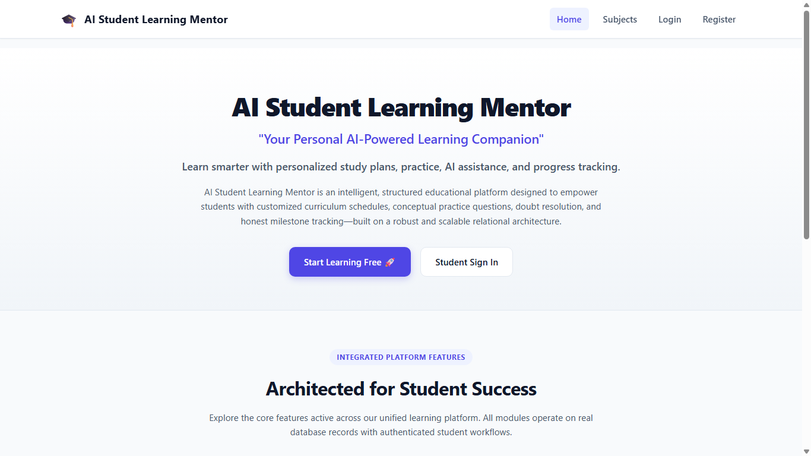</td>
<td>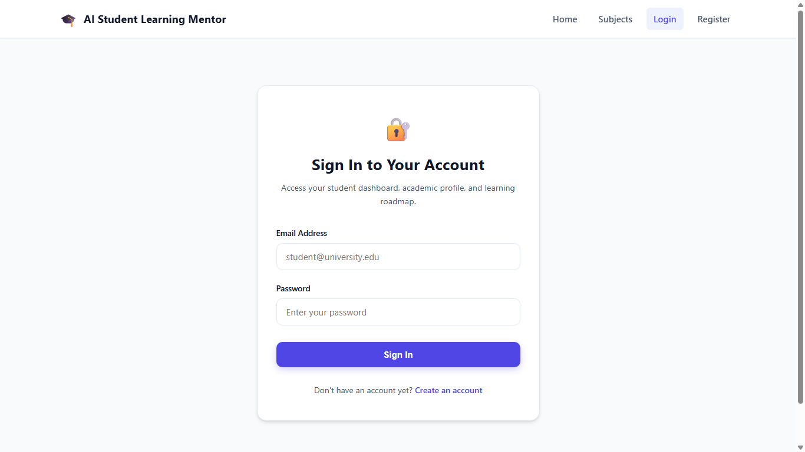</td>
</tr>
<tr>
<td width="50%" align="center"><b>Registration</b><br><sub>Validation, password confirmation, duplicate prevention</sub></td>
<td width="50%" align="center"><b>Subjects catalog</b><br><sub>Seven disciplines with difficulty filtering</sub></td>
</tr>
<tr>
<td>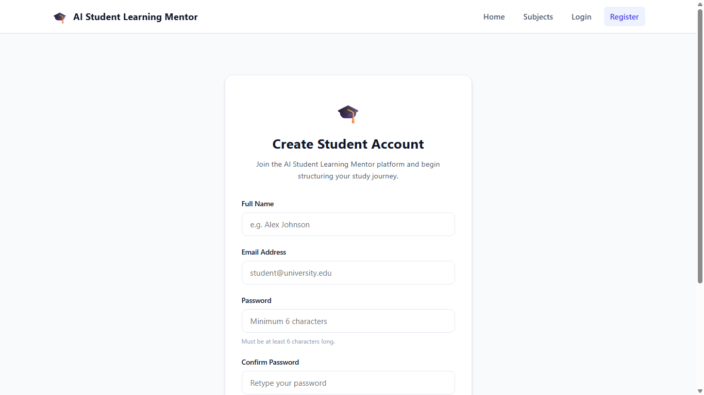</td>
<td>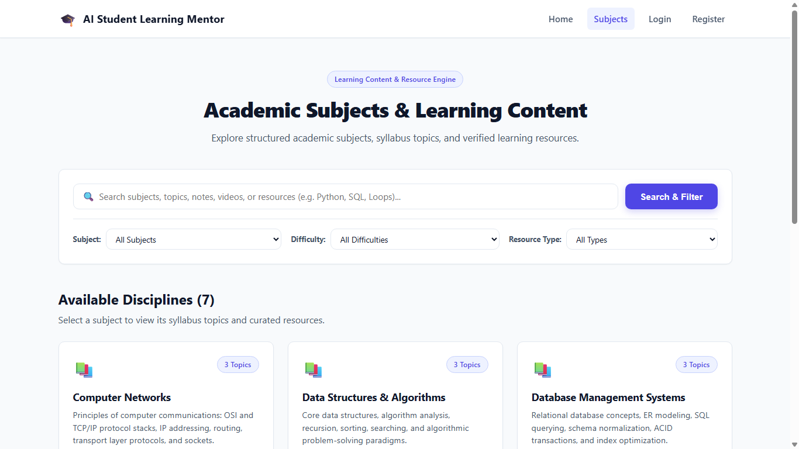</td>
</tr>
</table>

### 📊 Analytics & study workspace

<table>
<tr>
<td width="50%" align="center"><b>Student dashboard</b><br><sub>Mastery meters, subject cards, weak topics, activity feed</sub></td>
<td width="50%" align="center"><b>Progress center</b><br><sub>Evidence-based topic mastery and curriculum coverage</sub></td>
</tr>
<tr>
<td>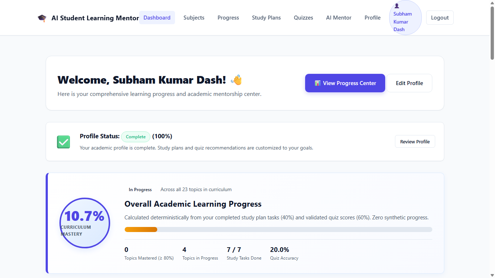</td>
<td>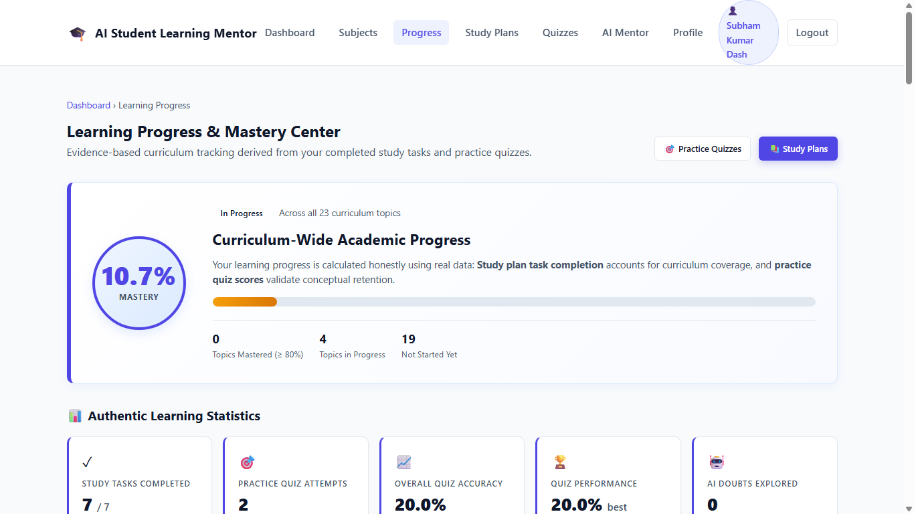</td>
</tr>
<tr>
<td width="50%" align="center"><b>Study plans</b><br><sub>Generated day-by-day schedules</sub></td>
<td width="50%" align="center"><b>Plan detail</b><br><sub>Daily tasks with completion toggling</sub></td>
</tr>
<tr>
<td>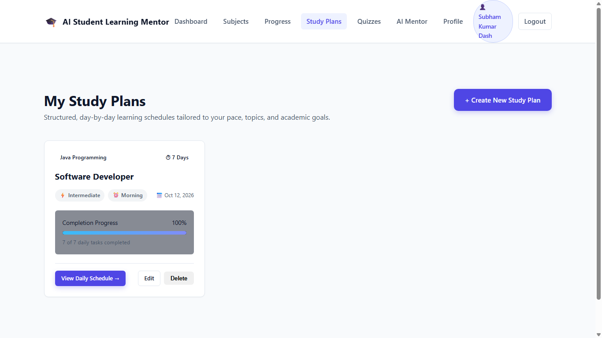</td>
<td>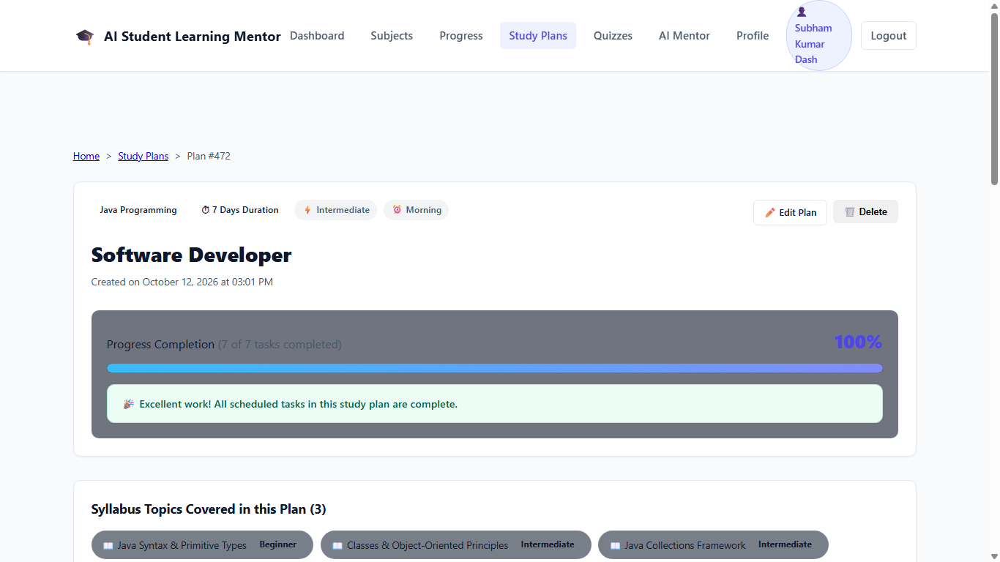</td>
</tr>
</table>

### 🤖 AI mentor & assessment

<table>
<tr>
<td width="50%" align="center"><b>AI doubt assistant</b><br><sub>Syllabus-aware Markdown explanations</sub></td>
<td width="50%" align="center"><b>Chat history</b><br><sub>Private, per-student conversation log</sub></td>
</tr>
<tr>
<td>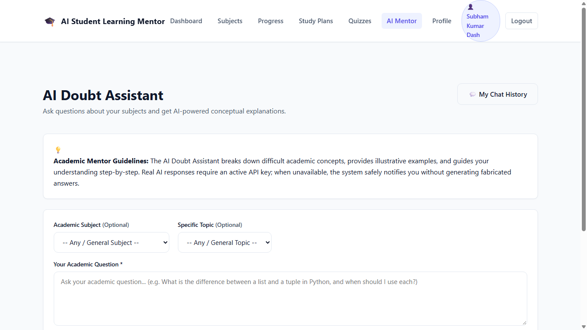</td>
<td>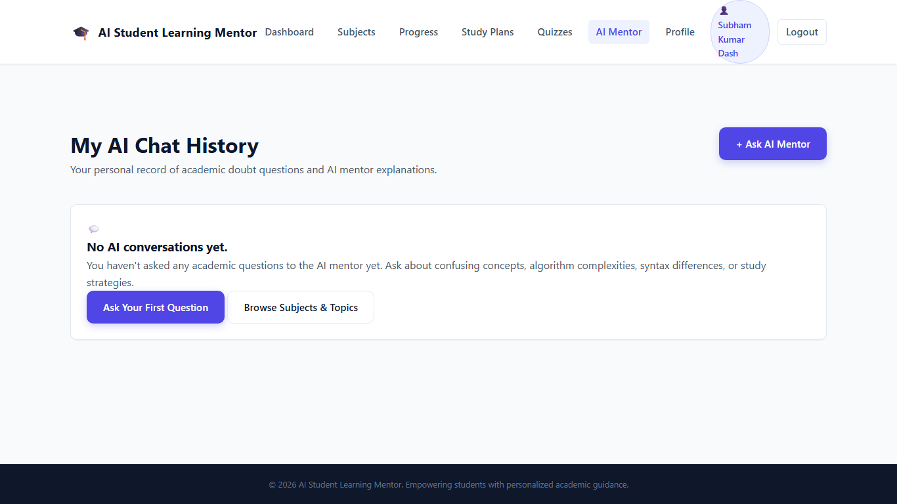</td>
</tr>
<tr>
<td width="50%" align="center"><b>Quiz briefing</b><br><sub>Instructions before an assessment</sub></td>
<td width="50%" align="center"><b>Quiz scorecard</b><br><sub>Server-graded results with tier feedback</sub></td>
</tr>
<tr>
<td>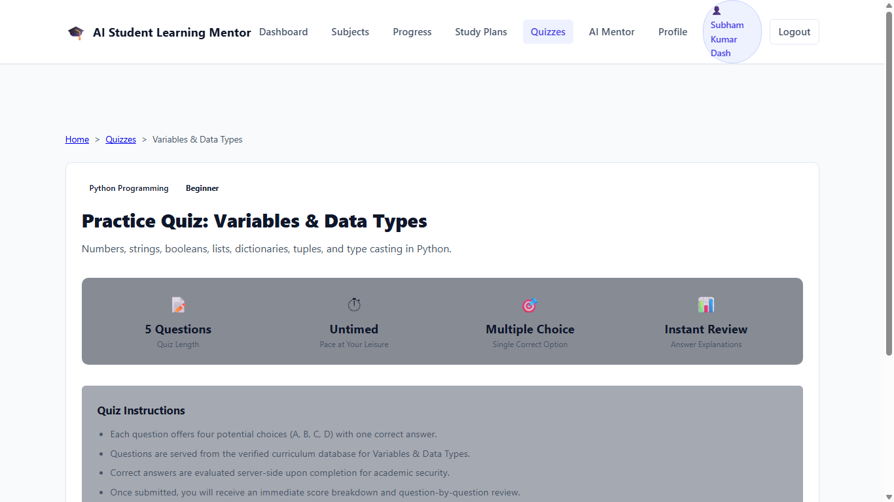</td>
<td>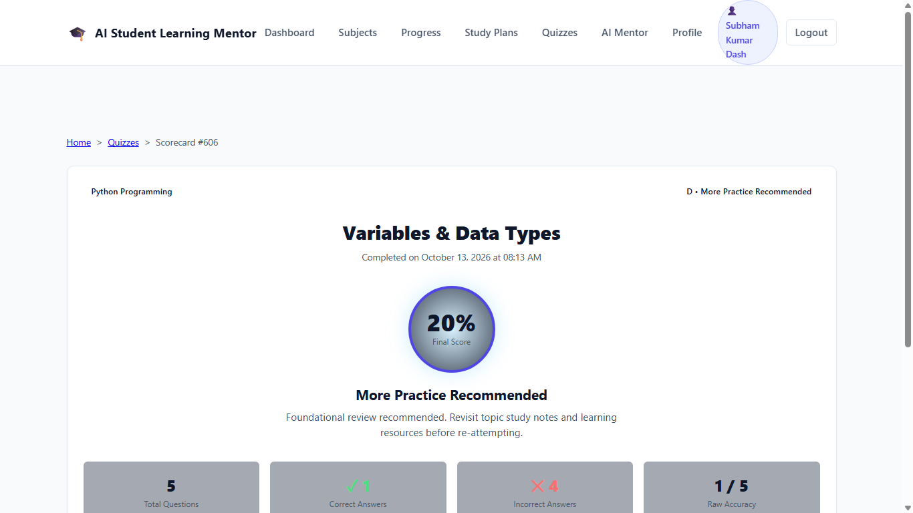</td>
</tr>
</table>

### 📱 Responsive layout

<table>
<tr>
<td width="33%" align="center"><b>Mobile · landing</b></td>
<td width="33%" align="center"><b>Mobile · dashboard</b></td>
<td width="33%" align="center"><b>Tablet · dashboard</b></td>
</tr>
<tr>
<td>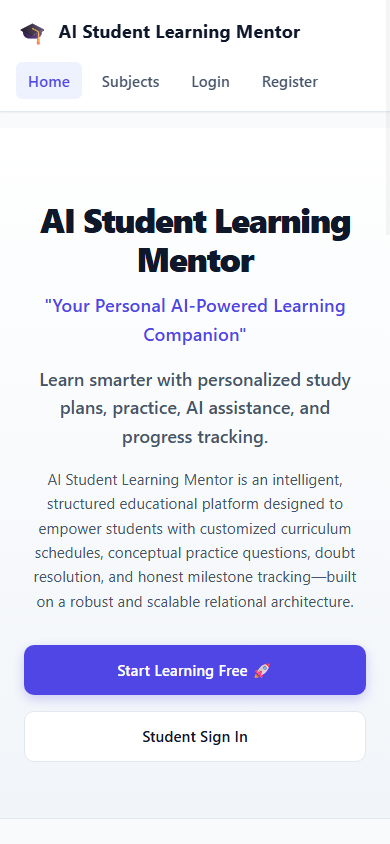</td>
<td>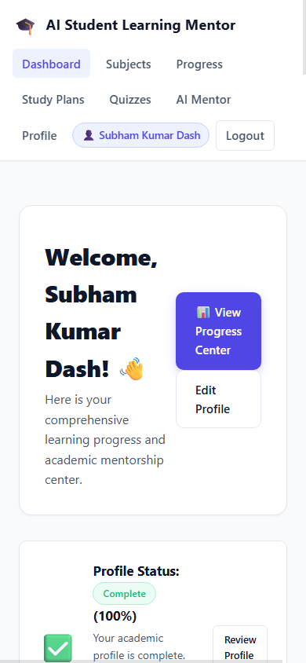</td>
<td>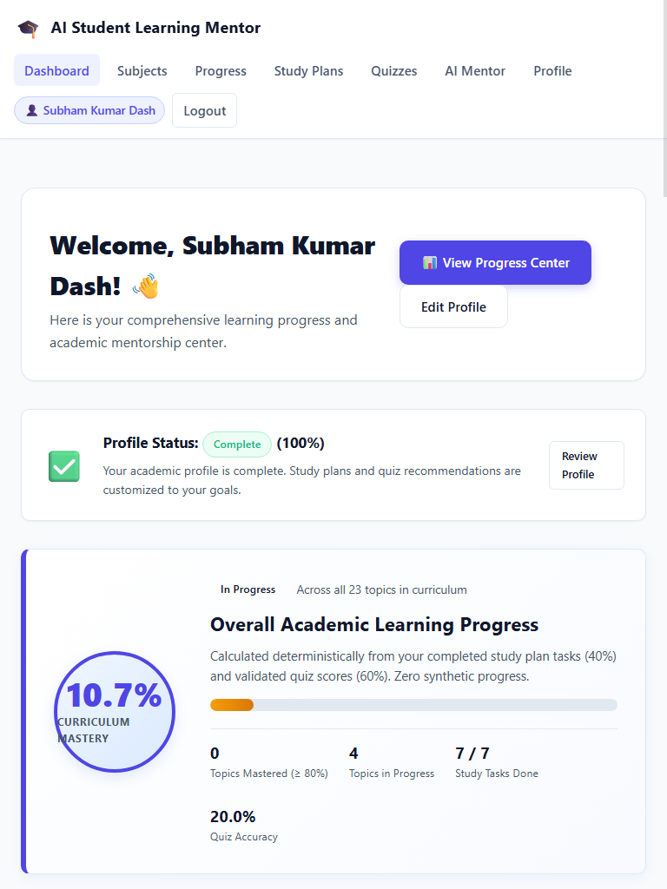</td>
</tr>
<tr>
<td width="33%" align="center"><b>Mobile · AI mentor</b></td>
<td width="33%" align="center"><b>Mobile · quiz</b></td>
<td width="33%" align="center"><b>Mobile · error page</b></td>
</tr>
<tr>
<td>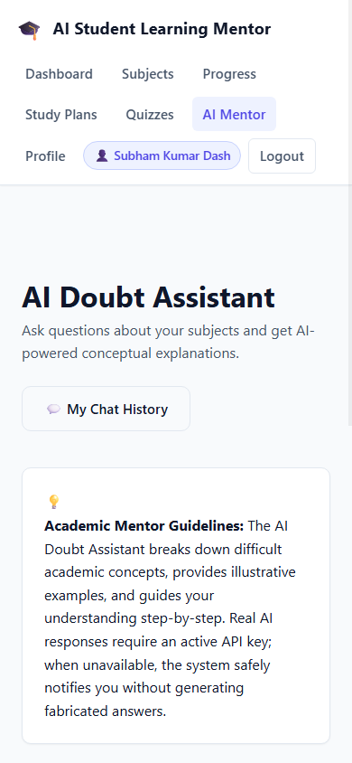</td>
<td>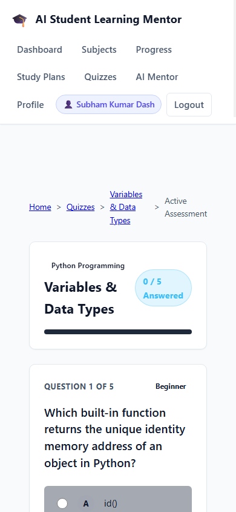</td>
<td>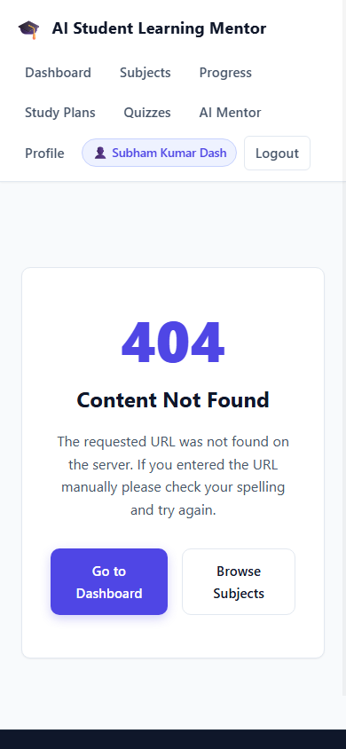</td>
</tr>
</table>

<details>
<summary><b>🗂️ Full screenshot index (60 captures)</b></summary>

<br>

| View | Desktop | Tablet | Mobile |
| :--- | :---: | :---: | :---: |
| Landing page | [`png`](docs/screenshots/phase_5_1/01_landing_page_desktop.png) | [`png`](docs/screenshots/phase_5_1/01_landing_page_tablet.png) | [`png`](docs/screenshots/phase_5_1/01_landing_page_mobile.png) |
| Sign in | [`png`](docs/screenshots/phase_5_1/02_login_page_desktop.png) | [`png`](docs/screenshots/phase_5_1/02_login_page_tablet.png) | [`png`](docs/screenshots/phase_5_1/02_login_page_mobile.png) |
| Registration | [`png`](docs/screenshots/phase_5_1/03_register_page_desktop.png) | [`png`](docs/screenshots/phase_5_1/03_register_page_tablet.png) | [`png`](docs/screenshots/phase_5_1/03_register_page_mobile.png) |
| Subjects catalog | [`png`](docs/screenshots/phase_5_1/04_subjects_catalog_desktop.png) | [`png`](docs/screenshots/phase_5_1/04_subjects_catalog_tablet.png) | [`png`](docs/screenshots/phase_5_1/04_subjects_catalog_mobile.png) |
| Subject detail | [`png`](docs/screenshots/phase_5_1/05_subject_detail_desktop.png) | [`png`](docs/screenshots/phase_5_1/05_subject_detail_tablet.png) | [`png`](docs/screenshots/phase_5_1/05_subject_detail_mobile.png) |
| Topic detail | [`png`](docs/screenshots/phase_5_1/06_topic_detail_desktop.png) | [`png`](docs/screenshots/phase_5_1/06_topic_detail_tablet.png) | [`png`](docs/screenshots/phase_5_1/06_topic_detail_mobile.png) |
| Quizzes catalog | [`png`](docs/screenshots/phase_5_1/07_quizzes_catalog_desktop.png) | [`png`](docs/screenshots/phase_5_1/07_quizzes_catalog_tablet.png) | [`png`](docs/screenshots/phase_5_1/07_quizzes_catalog_mobile.png) |
| Quiz briefing | [`png`](docs/screenshots/phase_5_1/08_quiz_briefing_desktop.png) | [`png`](docs/screenshots/phase_5_1/08_quiz_briefing_tablet.png) | [`png`](docs/screenshots/phase_5_1/08_quiz_briefing_mobile.png) |
| Quiz taking | [`png`](docs/screenshots/phase_5_1/09_quiz_taking_desktop.png) | [`png`](docs/screenshots/phase_5_1/09_quiz_taking_tablet.png) | [`png`](docs/screenshots/phase_5_1/09_quiz_taking_mobile.png) |
| Quiz result | [`png`](docs/screenshots/phase_5_1/10_quiz_result_desktop.png) | [`png`](docs/screenshots/phase_5_1/10_quiz_result_tablet.png) | [`png`](docs/screenshots/phase_5_1/10_quiz_result_mobile.png) |
| Dashboard | [`png`](docs/screenshots/phase_5_1/11_dashboard_desktop.png) | [`png`](docs/screenshots/phase_5_1/11_dashboard_tablet.png) | [`png`](docs/screenshots/phase_5_1/11_dashboard_mobile.png) |
| Profile | [`png`](docs/screenshots/phase_5_1/12_profile_desktop.png) | [`png`](docs/screenshots/phase_5_1/12_profile_tablet.png) | [`png`](docs/screenshots/phase_5_1/12_profile_mobile.png) |
| Study plans list | [`png`](docs/screenshots/phase_5_1/13_study_plans_list_desktop.png) | [`png`](docs/screenshots/phase_5_1/13_study_plans_list_tablet.png) | [`png`](docs/screenshots/phase_5_1/13_study_plans_list_mobile.png) |
| Study plan detail | [`png`](docs/screenshots/phase_5_1/14_study_plan_detail_desktop.png) | [`png`](docs/screenshots/phase_5_1/14_study_plan_detail_tablet.png) | [`png`](docs/screenshots/phase_5_1/14_study_plan_detail_mobile.png) |
| Create study plan | [`png`](docs/screenshots/phase_5_1/15_study_plan_create_desktop.png) | [`png`](docs/screenshots/phase_5_1/15_study_plan_create_tablet.png) | [`png`](docs/screenshots/phase_5_1/15_study_plan_create_mobile.png) |
| Progress center | [`png`](docs/screenshots/phase_5_1/16_progress_center_desktop.png) | [`png`](docs/screenshots/phase_5_1/16_progress_center_tablet.png) | [`png`](docs/screenshots/phase_5_1/16_progress_center_mobile.png) |
| AI doubt assistant | [`png`](docs/screenshots/phase_5_1/17_ai_chat_desktop.png) | [`png`](docs/screenshots/phase_5_1/17_ai_chat_tablet.png) | [`png`](docs/screenshots/phase_5_1/17_ai_chat_mobile.png) |
| AI chat history | [`png`](docs/screenshots/phase_5_1/18_ai_history_desktop.png) | [`png`](docs/screenshots/phase_5_1/18_ai_history_tablet.png) | [`png`](docs/screenshots/phase_5_1/18_ai_history_mobile.png) |
| 404 error | [`png`](docs/screenshots/phase_5_1/19_error_404_desktop.png) | [`png`](docs/screenshots/phase_5_1/19_error_404_tablet.png) | [`png`](docs/screenshots/phase_5_1/19_error_404_mobile.png) |
| 500 error | [`png`](docs/screenshots/phase_5_1/20_error_500_desktop.png) | [`png`](docs/screenshots/phase_5_1/20_error_500_tablet.png) | [`png`](docs/screenshots/phase_5_1/20_error_500_mobile.png) |

</details>

<div align="right"><sub><a href="#ai-student-learning-mentor">↑ Back to top</a></sub></div>


## 🎥 Demo

### ▶️ Run the guided demo locally

The fastest way to see the whole product is the end-to-end student journey - no external services required beyond the AI key.

```bash
python database/setup_db.py     # schema + reference content (idempotent)
python app.py                   # http://127.0.0.1:5000
```

| Step | Screen | What to look for |
| :---: | :--- | :--- |
| 1 | `/` | Landing page, feature grid, live `/api/health` badge |
| 2 | `/register` → `/login` | Password hashing, duplicatee-mail rejection, session cookie |
| 3 | `/profile` | Profile completion percentage updating live |
| 4 | `/subjects` → `/topics/1` | Curriculum drill-down with verified resources |
| 5 | `/study-plans/create` | Choose *Python Programming*, 7 days, target skill tier |
| 6 | `/study-plans/<id>` | Generated day-by-day schedule; toggle a task |
| 7 | `/quizzes/topic/1` | Quiz briefing → 5-question assessment |
| 8 | `/quiz/results/<id>` | Server-calculated score and tier feedback |
| 9 | `/quiz/results/<id>/review` | Submitted vs. verified correct answers |
| 10 | `/ai` | Ask an academic question → styled Markdown explanation |
| 11 | `/ai/history` | Private conversation log |
| 12 | `/progress` | Topic mastery bars and weak-topic recommendations |

### 🎬 Video walkthrough

<!-- Maintainers: drop the recorded walkthrough here. Keep the asset under 10 MB. -->

| Asset | Status | Notes |
| :--- | :---: | :--- |
| Animated GIF (`docs/assets/demo.gif`) | ⏳ not recorded | Keep under ~5 MB for inline playback |
| MP4 preview (`docs/assets/demo.mp4`) | ⏳ not recorded | H.264, 1080p, ~60 s |
| YouTube walkthrough | ⏳ not published | Replace the placeholder below when live |

<!--
[](https://www.youtube.com/watch?v=VIDEO_ID)
-->

> **Live deployment** - this project is a Flask + MySQL application, so it needs a Python runtime and a database. See [Deployment](#-deployment) for the hosting paths that fit; a public demo URL will be linked here once deployed and will replace this note.

<div align="right"><sub><a href="#ai-student-learning-mentor">↑ Back to top</a></sub></div>


## 🏗️ Architecture

The application follows a **modular MVC design with an explicit service layer** - presentation, routing, business logic, data access and persistence are separated so each can be tested in isolation.

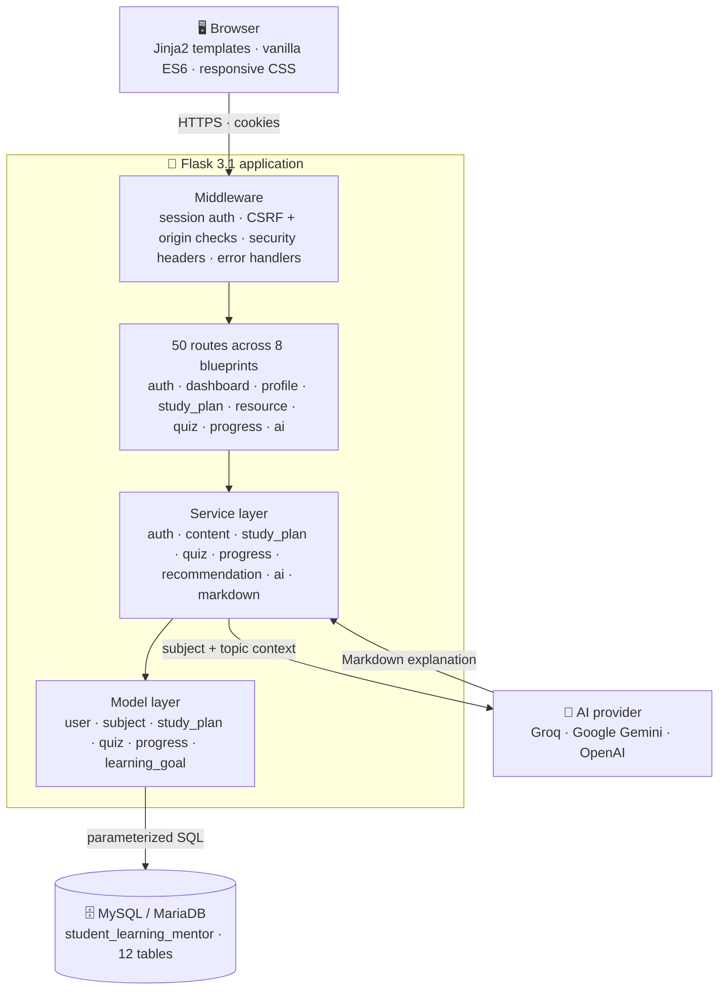

### 🔄 Request lifecycle for an AI doubt

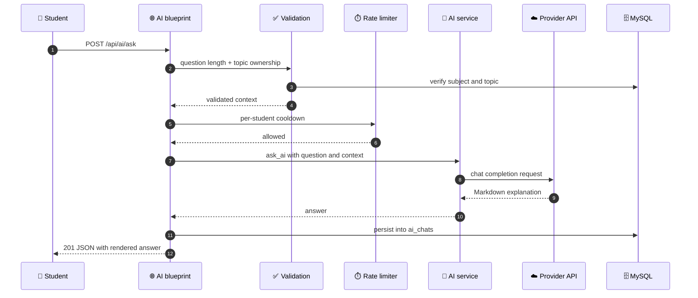

### 🗄️ Data model

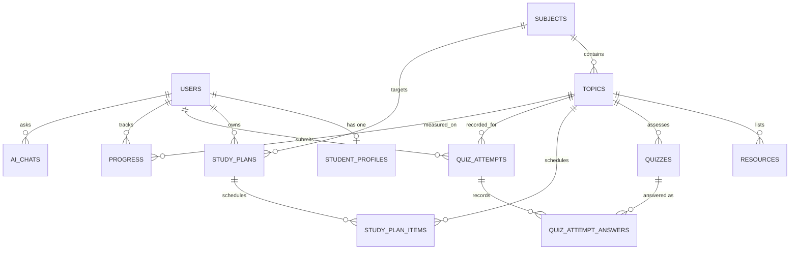

### 🧮 Progress model

Topic mastery is computed from authentic student actions only:

```
Topic progress =
   0.40 × task completion ratio + 0.60 × best quiz score     (tasks and quizzes)
   best quiz score                                            (quizzes only)
   0.75 × task completion ratio, capped at 75%                (tasks only)
   0.00%                                                      (no activity)
```

| Status | Rule |
| :--- | :--- |
| 🟢 Completed | mastery ≥ 80% |
| 🟡 In progress | 0% < mastery < 80% |
| ⚪ Not started | mastery = 0% |
| 🔴 Weak topic | ≥ 1 quiz attempt **and** average quiz score < 60% |

<details>
<summary><b>🔒 Security controls implemented at the application layer</b></summary>

<br>

| # | Control | Implementation |
| :---: | :--- | :--- |
| 1 | Password storage | Werkzeug `scrypt` / `pbkdf2:sha256` hashing with random salts |
| 2 | Session cookies | `HttpOnly`, `SameSite=Lax`, environment-driven `Secure` flag |
| 3 | Production boot guard | Refuses to start with a default `SECRET_KEY` when `FLASK_ENV=production` |
| 4 | Authorization | Every user-owned query filtered by `session['user_id']` (IDOR scoping) |
| 5 | CSRF | 64-char session tokens compared with `hmac.compare_digest`, plus origin/referer checks |
| 6 | SQL injection | 100% parameterized `%s` placeholders via PyMySQL |
| 7 | XSS | Global Jinja2 autoescaping; AI answers escaped **before** Markdown rendering; `textContent` in JS |
| 8 | Open redirect | `next` parameters validated against the request host |
| 9 | Secret isolation | Provider keys read server-side only; never echoed to templates, JSON errors or logs |
| 10 | Response headers | `X-Content-Type-Options: nosniff`, `X-Frame-Options: SAMEORIGIN`, `Referrer-Policy: strict-origin-when-cross-origin` |
| 11 | Error handling | Custom 400/401/403/404/405/429/500 handlers with no stack-trace leakage |

</details>

<div align="right"><sub><a href="#ai-student-learning-mentor">↑ Back to top</a></sub></div>


## 🛠️ Tech stack

<table>
<tr>
<td width="50%" valign="top">

**Backend**

[](https://www.python.org/)
[](https://flask.palletsprojects.com/)
[](https://jinja.palletsprojects.com/)
[](https://werkzeug.palletsprojects.com/)

**Database**

[](https://www.mysql.com/)
[](https://mariadb.org/)
[](https://pymysql.readthedocs.io/)

**AI / LLM**

[](https://console.groq.com/docs/models)
[](https://ai.google.dev/)
[](https://platform.openai.com/docs/api-reference)

</td>
<td width="50%" valign="top">

**Frontend**

[](https://developer.mozilla.org/docs/Web/HTML)
[](https://developer.mozilla.org/docs/Web/CSS)
[](https://developer.mozilla.org/docs/Web/JavaScript)

**Testing & tooling**

[](tests/)
[](https://git-scm.com/)
[](https://mermaid.js.org/)
[](https://shields.io/)

**Runtime & transport**

[](https://pypi.org/project/python-dotenv/)
[](https://requests.readthedocs.io/)
[](https://gunicorn.org/)

</td>
</tr>
</table>

<div align="right"><sub><a href="#ai-student-learning-mentor">↑ Back to top</a></sub></div>


## ⚡ Quick start

### Prerequisites

| Requirement | Version | Notes |
| :--- | :--- | :--- |
| Python | 3.10 - 3.14 | 3.10+ required for the type hints used across the codebase |
| MySQL or MariaDB | MySQL 8.0+ / MariaDB 10.4+ | XAMPP, Docker or a managed instance |
| AI provider key | optional | Required only for live AI explanations; the app runs without one |

<details>
<summary><b>✅ Verify your environment</b></summary>

<br>

```bash
python3 --version          # expect 3.10 or newer
mysql --version            # expect MySQL 8.x or MariaDB 10.4+
mysqladmin ping            # expect "mysqld is alive"
```
</details>

### 1 · Clone and install

```bash
git clone https://github.com/flawsom/AI-Student-Learning-Mentor.git
cd AI-Student-Learning-Mentor

python3 -m venv venv
source venv/bin/activate          # Windows: venv\Scripts\activate
pip install -r requirements.txt
```

### 2 · Configure the environment

```bash
cp .env.example .env
```

Edit `.env` - the defaults target a local XAMPP/MySQL install. See [Environment variables](#-environment-variables) for the full reference.

```ini
DB_HOST=localhost
DB_PORT=3306
DB_USER=root
DB_PASSWORD=
DB_NAME=student_learning_mentor

SECRET_KEY=change-this-secret-key
FLASK_ENV=development

AI_PROVIDER=groq
AI_API_KEY=gsk_your_key_here
AI_MODEL=openai/gpt-oss-120b
```

> ⚠️ **Never commit `.env`.** It is already covered by `.gitignore`. Generate a production key with `python -c "import secrets; print(secrets.token_hex(32))"`.

### 3 · Initialise the database

Start MySQL/MariaDB, then run the idempotent initialiser. It creates the schema, seeds the curriculum **and** loads the 115-question bank:

```bash
python database/setup_db.py
```

```text
Connecting to MySQL and executing schema.sql...
[SUCCESS] Database and tables initialized successfully.
- Connected: True
- Database Exists: True (student_learning_mentor)
- Tables Found: 12 of 12 required
[SUCCESS] All 12 required tables exist with valid schema!
```

### 4 · Run the application

```bash
python app.py
```

Open **http://127.0.0.1:5000** - the landing page shows a live health badge driven by `/api/health`.

### 5 · Docker

<details>
<summary><b>🐳 Dockerfile (multi-stage-free, slim base)</b></summary>

<br>

```dockerfile
FROM python:3.12-slim

ENV PYTHONUNBUFFERED=1 \
    PYTHONDONTWRITEBYTECODE=1

WORKDIR /app

RUN apt-get update \
    && apt-get install -y --no-install-recommends default-mysql-client \
    && rm -rf /var/lib/apt/lists/*

COPY requirements.txt .
RUN pip install --no-cache-dir -r requirements.txt gunicorn

COPY . .

EXPOSE 5000
CMD ["gunicorn", "-w", "4", "-b", "0.0.0.0:5000", \
     "--access-logfile", "-", "--error-logfile", "-", "app:create_app()"]
```
</details>

<details>
<summary><b>🐳 docker-compose.yml (app + MySQL, schema applied on boot)</b></summary>

<br>

```yaml
services:
  db:
    image: mysql:8.0
    environment:
      MYSQL_ROOT_PASSWORD: root
      MYSQL_DATABASE: student_learning_mentor
    ports:
      - "3306:3306"
    volumes:
      - db_data:/var/lib/mysql
    healthcheck:
      test: ["CMD", "mysqladmin", "ping", "-h", "127.0.0.1", "-proot"]
      interval: 5s
      timeout: 5s
      retries: 20

  app:
    build: .
    environment:
      DB_HOST: db
      DB_PORT: "3306"
      DB_USER: root
      DB_PASSWORD: root
      DB_NAME: student_learning_mentor
      SECRET_KEY: change-this-secret-key
      FLASK_ENV: development
      AI_PROVIDER: groq
      AI_API_KEY: ${AI_API_KEY:-}
      AI_MODEL: openai/gpt-oss-120b
    ports:
      - "5000:5000"
    depends_on:
      db:
        condition: service_healthy
    command: >
      sh -c "python database/setup_db.py &&
             gunicorn -w 4 -b 0.0.0.0:5000 app:create_app()"

volumes:
  db_data:
```
</details>

```bash
AI_API_KEY=gsk_your_key_here docker compose up --build
```

<div align="right"><sub><a href="#ai-student-learning-mentor">↑ Back to top</a></sub></div>


## 📁 Project structure

```text
AI-Student-Learning-Mentor/
├── app.py                      # Application factory, middleware, error handlers, health check
├── config.py                   # Environment-driven configuration (base + test)
├── requirements.txt            # Runtime dependencies
├── .env.example                # Environment template (never commit a real .env)
│
├── routes/                     # HTTP layer - 8 blueprints, 50 routes
│   ├── auth_routes.py          #   register · login · logout (+ safe-redirect guard)
│   ├── dashboard_routes.py     #   student dashboard
│   ├── profile_routes.py       #   academic profile management
│   ├── study_plan_routes.py    #   plan creation, detail, task toggling, deletion
│   ├── resource_routes.py      #   subjects · topics · resources catalog + JSON APIs
│   ├── quiz_routes.py          #   briefing, taking, submission, results, review, history
│   ├── progress_routes.py      #   progress center + 5 JSON analytics endpoints
│   └── ai_routes.py            #   AI assistant page, ask endpoints, chat history
│
├── services/                   # Business logic (framework-independent)
│   ├── auth_service.py         #   registration, authentication, hashing
│   ├── auth_middleware.py      #   @login_required decorator (HTML + JSON aware)
│   ├── csrf_service.py         #   session-backed CSRF token issue/verify
│   ├── content_service.py      #   curriculum queries, search and filtering
│   ├── study_plan_service.py   #   deterministic pacing engine (1-60 days)
│   ├── quiz_service.py         #   server-side grading and attempt persistence
│   ├── progress_service.py     #   mastery weighting, weak topics, statistics
│   ├── recommendation_service.py  # next steps and reinforcement suggestions
│   ├── ai_service.py           #   provider abstraction (Groq · Gemini · OpenAI · mock)
│   ├── markdown_service.py     #   escape-first Markdown → safe HTML renderer
│   ├── profile_service.py      #   profile upsert + completion scoring
│   └── db.py                   #   connection + health facade over database/
│
├── models/                     # Data access - parameterized SQL only
│   ├── user_model.py           #   users, student_profiles
│   ├── subject_model.py        #   subjects, topics, resources
│   ├── study_plan_model.py     #   study_plans, study_plan_items
│   ├── quiz_model.py           #   quizzes, quiz_attempts, quiz_attempt_answers
│   ├── progress_model.py       #   progress, ai_chats, activity aggregation
│   └── learning_goal_model.py  #   learning-goal lookups
│
├── database/
│   ├── schema.sql              # DDL for 12 tables + curriculum seed data
│   ├── seed_quizzes.sql        # 115-question practice bank (idempotent)
│   ├── seed_content.py         # Reference content seeding helpers
│   ├── seed_data.sql           # Curriculum seed data (SQL form)
│   ├── setup_db.py             # One-command initialiser
│   └── db_connection.py        # PyMySQL connections, health checks, schema application
│
├── templates/                  # Jinja2 views, grouped by feature
├── static/
│   ├── css/                    # 6 stylesheets (style · auth · dashboard · quiz · study_plan · chat)
│   └── js/                     # 6 vanilla ES6 modules - no framework, no bundler
│
├── data/                       # JSON mirrors of the Python curriculum reference content
├── ai_engine/                  # Reserved package for future AI model work
│
├── tests/                      # 206 unittest cases across 10 suites
├── docs/
│   ├── assets/                 # Logo, banner and divider SVGs
│   ├── screenshots/            # Desktop / tablet / mobile captures
│   ├── project_report.md       # Academic project report
│   └── lean_canvas.md          # Product discovery canvas
│
├── backups/                    # Historical database dump (pre-dates the current schema)
└── scratch/                    # Ad-hoc verification and browser smoke scripts
```

<div align="right"><sub><a href="#ai-student-learning-mentor">↑ Back to top</a></sub></div>


## 🔐 Environment variables

| Variable | Default | Required | Description |
| :--- | :--- | :---: | :--- |
| `DB_HOST` | `localhost` | ✅ | MySQL/MariaDB host |
| `DB_PORT` | `3306` | ✅ | Database port |
| `DB_USER` | `root` | ✅ | Database user |
| `DB_PASSWORD` | *(empty)* | ✅ | Database password (blank is valid for a default XAMPP root) |
| `DB_NAME` | `student_learning_mentor` | ✅ | Schema name |
| `TEST_DB_NAME` | falls back to `DB_NAME` | - | Schema used by the test configuration |
| `SECRET_KEY` | `change-this-secret-key` | ✅ | Session signing key. **Must** be replaced in production |
| `FLASK_ENV` | `development` | ✅ | `development` or `production` (production enforces a real `SECRET_KEY`) |
| `SESSION_COOKIE_SECURE` | `false` | - | Set `true` behind HTTPS |
| `CSRF_ENABLED` | `true` | - | Enables CSRF + origin verification on write requests |
| `CSRF_STRICT` | `false` | - | When `true`, rejects write requests that omit a token entirely |
| `PERMANENT_SESSION_LIFETIME` | `86400` | - | Session lifetime in seconds |
| `AI_PROVIDER` | `gemini` | - | `groq` · `gemini` · `openai` · `mock` |
| `AI_API_KEY` | *(empty)* | - | Provider key. Absent → the assistant reports unavailability instead of inventing answers |
| `AI_MODEL` | provider default | - | Empty ⇒ `gemini-1.5-flash`, `gpt-3.5-turbo` or `openai/gpt-oss-120b` based on the provider |
| `AI_RATE_LIMIT_SECONDS` | `5` | - | Minimum seconds between two questions from the same student |

<details>
<summary><b>🤖 Choosing an AI provider</b></summary>

<br>

| Provider | `AI_PROVIDER` | Suggested `AI_MODEL` | Notes |
| :--- | :--- | :--- | :--- |
| Groq | `groq` | `openai/gpt-oss-120b` | OpenAI-compatible endpoint, generous free tier. Also `openai/gpt-oss-20b`, `qwen/qwen3.8-27b` |
| Google Gemini | `gemini` | `gemini-1.5-flash` | Native `generateContent` REST API |
| OpenAI | `openai` | `gpt-3.5-turbo` | Chat Completions API |
| Mock | `mock` | - | Deterministic offline provider used by the automated tests |

Switching `AI_PROVIDER` alone is enough - leaving `AI_MODEL` empty selects that provider's default model, so a foreign model name is never sent to the wrong API.

</details>

<div align="right"><sub><a href="#ai-student-learning-mentor">↑ Back to top</a></sub></div>


## 📖 API reference

**Base URL** - `http://127.0.0.1:5000`

**Authentication** - session cookie based. Sign in through `POST /login` (form-encoded), then reuse the session cookie. Write requests are additionally protected by the session CSRF token (`csrf_token` form field or `X-CSRF-Token` header) and by an origin/referer check on cross-origin calls. Unauthenticated `/api/*` requests receive `401` with a JSON body; unauthenticated HTML routes redirect to `/login`.

**Response envelope** - API endpoints return `{"status": "success", …, }` or `{"success": true, …}` depending on the blueprint; errors return a `message` field.

<details>
<summary><b>🔎 Full endpoint table (50 routes)</b></summary>

<br>

| Method | Path | Auth | Purpose |
| :---: | :--- | :---: | :--- |
| `GET` | `/` | - | Landing page |
| `GET` | `/api/health` | - | Database + application health probe |
| `GET` `POST` | `/register` | - | Create a student account |
| `GET` `POST` | `/login` | - | Authenticate and open a session |
| `GET` | `/logout` | ✅ | Destroy the session |
| `GET` | `/dashboard` | ✅ | Student dashboard |
| `GET` `POST` | `/profile` | ✅ | View and update the academic profile |
| `GET` | `/subjects` | ✅ | Curriculum catalog |
| `GET` | `/subjects/<subject_id>` | ✅ | Subject detail with its topics |
| `GET` | `/topics/<topic_id>` | ✅ | Topic detail with verified resources |
| `GET` | `/study-plans` | ✅ | List the student's study plans |
| `GET` `POST` | `/study-plans/create` | ✅ | Generate a plan (1-60 days, topic selection) |
| `GET` | `/study-plans/<plan_id>` | ✅ | Plan detail with daily tasks |
| `GET` `POST` | `/study-plans/<plan_id>/edit` | ✅ | Edit plan metadata |
| `POST` | `/study-plans/<plan_id>/delete` | ✅ | Delete a plan |
| `POST` | `/study-plans/<plan_id>/items/<item_id>/toggle` | ✅ | Complete or revert a task |
| `GET` | `/quizzes` | ✅ | Practice quiz catalog |
| `GET` | `/quizzes/topic/<topic_id>` | ✅ | Quiz briefing for a topic |
| `GET` | `/quiz/topic/<topic_id>/start` | ✅ | Take a quiz |
| `GET` | `/quiz/<topic_id>/start` | ✅ | Take a quiz (alias route) |
| `POST` | `/quiz/<topic_id>/submit` | ✅ | Submit responses (server-side grading) |
| `POST` | `/quiz/submit` | ✅ | Submit responses (alias route) |
| `GET` | `/quiz/results/<attempt_id>` | ✅ | Scorecard for an attempt |
| `GET` | `/quiz/results/<attempt_id>/review` | ✅ | Answer-by-answer review |
| `GET` | `/quiz/history` | ✅ | Past attempts |
| `GET` | `/progress` | ✅ | Progress center |
| `GET` | `/ai` | ✅ | AI doubt assistant |
| `POST` | `/ai/ask` | ✅ | Ask via the HTML form |
| `GET` | `/ai/history` | ✅ | Private AI conversation log |
| `GET` | `/api/subjects` | - | Subjects as JSON |
| `GET` | `/api/subjects/<subject_id>` | - | Single subject with topics |
| `GET` | `/api/subjects/<subject_id>/topics` | - | Topics of a subject |
| `GET` | `/api/topics/<topic_id>` | - | Single topic with resources |
| `GET` | `/api/resources` | - | Resource catalog with filters |
| `GET` | `/api/study-plans` | ✅ | Study plans as JSON |
| `GET` | `/api/study-plans/<plan_id>` | ✅ | Single plan detail |
| `POST` | `/api/study-plans/<plan_id>/items/<item_id>/toggle` | ✅ | Toggle a task via JSON |
| `GET` | `/api/quizzes/topic/<topic_id>` | ✅ | Quiz questions for a topic (answers withheld) |
| `POST` | `/api/quizzes/topic/<topic_id>/submit` | ✅ | Grade a submission |
| `POST` | `/api/quizzes/<topic_id>/submit` | ✅ | Grade a submission (alias route) |
| `GET` | `/api/quiz-attempts` | ✅ | Attempt history as JSON |
| `GET` | `/api/quiz-attempts/<attempt_id>` | ✅ | Single attempt with answers |
| `GET` | `/api/progress` | ✅ | Overall progress, statistics and subjects |
| `GET` | `/api/progress/subjects` | ✅ | Subject-level mastery |
| `GET` | `/api/progress/topics` | ✅ | Topic-level mastery (`?subject_id=` filter) |
| `GET` | `/api/progress/statistics` | ✅ | Task, quiz and AI-doubt counters |
| `GET` | `/api/progress/activity` | ✅ | Chronological activity stream |
| `POST` | `/api/ai/ask` | ✅ | Ask the AI mentor (JSON) |
| `GET` | `/api/ai/history` | ✅ | AI conversation history (JSON) |
| `GET` | `/api/ai/history/<chat_id>` | ✅ | Single conversation (ownership checked) |

</details>

<details open>
<summary><b>🩺 GET /api/health</b> - public health probe</summary>

<br>

```bash
curl http://127.0.0.1:5000/api/health
```

```json
{
  "database": {
    "connected": true,
    "database_exists": true,
    "database_name": "student_learning_mentor"
  },
  "phase": 9,
  "project": "AI Student Learning Mentor",
  "status": "healthy"
}
```

Returns `200` when the database is reachable and `503` otherwise. Credentials are never included.
</details>

<details>
<summary><b>🤖 POST /api/ai/ask</b> - ask the AI mentor</summary>

<br>

```bash
curl -X POST http://127.0.0.1:5000/api/ai/ask \
  -b cookies.txt \
  -H "Content-Type: application/json" \
  -d '{"question": "Why is a Python tuple immutable?", "subject_id": 1, "topic_id": 4}'
```

**Request body**

| Field | Type | Required | Notes |
| :--- | :--- | :---: | :--- |
| `question` | string | ✅ | 3-2000 characters after trimming |
| `subject_id` | integer | - | Injects subject context; must exist |
| `topic_id` | integer | - | Must exist **and** belong to `subject_id` |

**Responses**

```json
// 201 Created
{
  "success": true,
  "answer": "A tuple is immutable because ...",
  "chat_id": 42
}
```

```json
// 503 Service Unavailable - no key configured or provider failure
{
  "success": false,
  "message": "AI assistant is currently unavailable. Please configure the AI service."
}
```

```json
// 429 Too Many Requests - per-student cooldown
{
  "success": false,
  "message": "Please wait 3 seconds before asking another academic question."
}
```

Answers are persisted to `ai_chats` only after a successful provider response, so failed queries never create fabricated history. The HTML route renders the answer as safe Markdown; the JSON route returns the raw Markdown.
</details>

<details>
<summary><b>📝 POST /api/quizzes/topic/&lt;topic_id&gt;/submit</b> - submit an assessment</summary>

<br>

```bash
curl -X POST http://127.0.0.1:5000/api/quizzes/topic/4/submit \
  -b cookies.txt \
  -H "Content-Type: application/json" \
  -d '{"answers": {"26": "B", "27": "A", "28": "B", "29": "B", "30": "B"}}'
```

Grading is performed against the authoritative answers stored in MySQL; submitted question IDs are verified to belong to `topic_id`. Correct answers are never present in the GET response, so a client cannot pre-compute a score.
</details>

<details>
<summary><b>📊 GET /api/progress</b> - dashboard aggregates</summary>

<br>

```json
{
  "status": "success",
  "overall_progress": 42.5,
  "statistics": {
    "total_study_tasks": 14,
    "completed_study_tasks": 9,
    "total_quiz_attempts": 5,
    "best_quiz_score": 80.0,
    "total_ai_doubts_asked": 3
  },
  "subjects": [
    { "subject_id": 1, "subject_name": "Python Programming", "progress_percentage": 61.0 }
  ]
}
```
</details>

<div align="right"><sub><a href="#ai-student-learning-mentor">↑ Back to top</a></sub></div>


## 🎯 Usage examples

<details open>
<summary><b>🧑‍🎓 Student journey (web)</b></summary>

<br>

1. Register at `/register`, sign in at `/login`.
2. Complete `/profile` - education level, course, semester, skill tier.
3. Browse `/subjects`, open `/topics/1`, follow a verified resource.
4. Create a 7-day plan at `/study-plans/create`, then work through `/study-plans/<id>`.
5. Take the topic quiz, review missed answers, and ask the mentor from `/ai`.
6. Watch mastery move on `/progress` and `/dashboard`.

</details>

<details>
<summary><b>🐍 Driving the AI service directly (Python)</b></summary>

<br>

```python
from services.ai_service import ask_ai, validate_academic_question, save_ai_chat

ok, error, context = validate_academic_question(
    "Explain the difference between a list and a tuple.",
    subject_id=1,
    topic_id=4,
)
assert ok, error

success, answer = ask_ai(
    question=context["question"],
    subject_name=context["subject_name"],
    topic_name=context["topic_name"],
)
if success:
    save_ai_chat(user_id=1, question=context["question"], answer=answer)
```

`ask_ai` respects `AI_PROVIDER` / `AI_MODEL` / `AI_API_KEY`, or accepts explicit `provider`, `model` and `api_key` overrides for scripting and tests.
</details>

<details>
<summary><b>🗓️ Generating a study plan</b></summary>

<br>

```python
from services.study_plan_service import create_study_plan

success, message, plan_id = create_study_plan(
    user_id=1,
    subject_id=1,
    topic_ids=[1, 2, 3, 4],
    duration_days=7,
    goal="Finish the Python fundamentals module before midsem",
)
```

The engine distributes the topics across the requested duration according to the student's `skill_level`, then materialises one `study_plan_items` row per day.
</details>

<details>
<summary><b>🌐 API-only flow with curl</b></summary>

<br>

```bash
# 1 - authenticate and keep the session cookie
curl -c cookies.txt -X POST http://127.0.0.1:5000/login \
  -d "email=student@example.com&password=Password123!"

# 2 - read the curriculum as JSON
curl -b cookies.txt http://127.0.0.1:5000/api/subjects/1

# 3 - ask the AI mentor with topic context
curl -b cookies.txt -X POST http://127.0.0.1:5000/api/ai/ask \
  -H "Content-Type: application/json" \
  -d '{"question":"What is the time complexity of binary search?","topic_id":9}'

# 4 - inspect progress aggregates
curl -b cookies.txt http://127.0.0.1:5000/api/progress
```

</details>

<div align="right"><sub><a href="#ai-student-learning-mentor">↑ Back to top</a></sub></div>


## 📊 Performance

All figures below are measured on the reference environment (Python 3.10, MariaDB 10.6, single process, warm connection, local test client) rather than estimated.

### Server-side response latency

| Route | Median | Mean | p95 |
| :--- | ---: | ---: | ---: |
| `/` (landing) | **0.5 ms** | 0.5 ms | 0.6 ms |
| `/subjects` (7 subjects, 23 topics) | **3.7 ms** | 4.0 ms | 4.5 ms |
| `/quizzes` (catalog) | **0.6 ms** | 0.6 ms | 0.7 ms |
| `/api/health` (DB round-trip) | **1.9 ms** | 1.9 ms | 2.0 ms |

### Frontend payload

| Asset group | Size | Files |
| :--- | ---: | :---: |
| CSS | 77.4 KB | 6 |
| JavaScript | 15.4 KB | 6 |
| **Total shipped frontend** | **92.8 KB** | 12 |

No frontend framework, no bundler and no client-side build step - the browser downloads plain CSS and ES6 modules.

### Test-suite timing

| Metric | Value |
| :--- | :--- |
| Full regression suite | **206 tests in ~40-50 s** |
| Suites | 10 modules |
| External dependencies during tests | none (database only; AI provider is mocked) |

### Database footprint

| Table | Rows (reference seed) |
| :--- | ---: |
| `subjects` | 7 |
| `topics` | 23 |
| `resources` | 25 |
| `quizzes` | 115 |

> **Not yet measured** - Lighthouse/PWA scores, first contentful paint, and time-to-interactive require an instrumented browser audit; they are intentionally omitted rather than estimated. The mobile/tablet/desktop captures under [`docs/screenshots/`](docs/screenshots) were taken from real browser sessions.

<div align="right"><sub><a href="#ai-student-learning-mentor">↑ Back to top</a></sub></div>


## 🧪 Testing

The project ships **206 automated unit and integration tests** across 10 suites, covering authentication, curriculum, study plans, quizzes, progress, recommendations, the AI assistant and application-level security hardening.

```bash
python -m unittest discover -s tests -p "test_*.py"
```

```text
Ran 206 tests in 47.3s

OK
```

<details open>
<summary><b>📋 Suite breakdown</b></summary>

<br>

| Test module | Scope | Tests |
| :--- | :--- | ---: |
| `tests/test_quizzes.py` | Catalog, briefing, cheat-resistance, grading, review, history | 30 |
| `tests/test_ai_assistant.py` | AI assistant: validation, context, rate limits, XSS-safe rendering, history isolation | 28 |
| `tests/test_progress.py` | Mastery weighting, weak topics, aggregates, activity stream, isolation | 26 |
| `tests/test_security_hardening.py` | CSRF enforcement, IDOR isolation, open-redirect guard, header checks | 25 |
| `tests/test_study_plans.py` | Plan creation, pacing by skill tier, task toggling, deletion | 25 |
| `tests/test_learning_content.py` | Subject/topic/resource catalog, search and filtering, safety rules | 19 |
| `tests/test_system_integration.py` | End-to-end flows, CSRF validation, and the health endpoint | 16 |
| `tests/test_auth_profile.py` | Registration, login, sessions, profile updates | 15 |
| `tests/test_foundation.py` | Database connectivity, schema integrity, foreign keys, hashing | 12 |
| `tests/test_recommendations.py` | Next-step and reinforcement recommendations | 10 |
| **Total** | | **206** |

</details>

<details>
<summary><b>📈 Running a single suite or a single test</b></summary>

<br>

```bash
# One suite
python -m unittest tests.test_ai_assistant -v

# One test case
python -m unittest tests.test_quizzes.TestPhase5QuizEngine.test_09_valid_quiz_submission_calculates_correct_score

# Stop at the first failure
python -m unittest discover -s tests -p "test_*.py" -f
```
</details>

<details>
<summary><b>📊 Coverage, linting and formatting</b></summary>

<br>

No linter, formatter or coverage gate is wired into this repository yet, so the commands below are the recommended additions rather than an existing configuration.

```bash
# Coverage
pip install coverage
coverage run -m unittest discover -s tests -p "test_*.py"
coverage report -m
coverage html          # -> htmlcov/index.html

# Linting (recommended)
pip install ruff
ruff check .

# Formatting (recommended)
pip install black
black --check .
black .
```

**Testing conventions used in this repository**

- Tests run against a real MySQL schema - no mocked data layer - so SQL regressions surface immediately.
- External AI providers are replaced with the deterministic `mock` provider; no network calls and no API quota are consumed.
- Every suite cleans up the records it creates, so the suite is re-runnable and order-independent.
- Security expectations are asserted directly (e.g. raw `<script>` from a provider response must appear HTML-escaped, never executable).

</details>

<div align="right"><sub><a href="#ai-student-learning-mentor">↑ Back to top</a></sub></div>


## 🚀 Deployment

This is a **Python/WSGI application with a relational database**, so it needs a host that runs a Python process and reachable MySQL. Static-first platforms (Vercel, Netlify, GitHub Pages) cannot run the Flask backend; use them only for a static marketing page.

### Production server

```bash
pip install gunicorn

gunicorn -w 4 -b 127.0.0.1:5000 \
  --access-logfile - --error-logfile - \
  "app:create_app()"
```

Behind Nginx, terminate TLS and proxy to Gunicorn:

```nginx
server {
    listen 443 ssl http2;
    server_name mentor.example.edu;

    ssl_certificate     /etc/letsencrypt/live/mentor.example.edu/fullchain.pem;
    ssl_certificate_key /etc/letsencrypt/live/mentor.example.edu/privkey.pem;

    add_header X-Frame-Options "SAMEORIGIN" always;
    add_header X-Content-Type-Options "nosniff" always;
    add_header Referrer-Policy "strict-origin-when-cross-origin" always;

    location /static/ { alias /var/www/AI-Student-Learning-Mentor/static/; expires 30d; }

    location / {
        proxy_pass http://127.0.0.1:5000;
        proxy_set_header Host $host;
        proxy_set_header X-Real-IP $remote_addr;
        proxy_set_header X-Forwarded-For $proxy_add_x_forwarded_for;
        proxy_set_header X-Forwarded-Proto $scheme;
    }
}
```

<details>
<summary><b>🐳 Docker (any VPS or PaaS with container support)</b></summary>

<br>

```bash
AI_API_KEY=gsk_... docker compose up --build -d
docker compose exec app python database/setup_db.py
```

Add the `Dockerfile` and `docker-compose.yml` from [Quick start → Docker](#-quick-start) first.
</details>

<details>
<summary><b>🚂 Railway</b></summary>

<br>

1. Create a project and add the **MySQL** plugin.
2. Deploy the repository; Railway detects Python and uses `requirements.txt`.
3. Set environment variables: `DB_HOST`, `DB_PORT`, `DB_USER`, `DB_PASSWORD`, `DB_NAME` (from the MySQL plugin), plus `SECRET_KEY`, `FLASK_ENV=production`, `SESSION_COOKIE_SECURE=true` and the AI variables.
4. Set the start command:

```bash
gunicorn -w 4 -b 0.0.0.0:$PORT "app:create_app()"
```

5. Run the initialiser once from the Railway shell: `python database/setup_db.py`.
</details>

<details>
<summary><b>🟣 Render</b></summary>

<br>

1. **New → Web Service**, connect the repository.
2. Build command: `pip install -r requirements.txt gunicorn`
3. Start command: `gunicorn -w 4 -b 0.0.0.0:$PORT "app:create_app()"`
4. Add a MySQL instance (Render Private Service or an external provider) and set `DB_*`, `SECRET_KEY`, `FLASK_ENV=production`.
5. Health check path: `/api/health`.
</details>

<details>
<summary><b>☁️ AWS</b></summary>

<br>

- **Compute:** Elastic Beanstalk (Python platform), ECS/Fargate with the Docker image, or EC2 behind an Application Load Balancer.
- **Database:** RDS for MySQL 8.0 in a private subnet; store credentials in Secrets Manager or SSM Parameter Store.
- **TLS:** ACM certificate on the load balancer; set `SESSION_COOKIE_SECURE=true`.
- **Assets:** CloudFront in front of `/static/`.
- **Initialisation:** run `python database/setup_db.py` once from a bastion or a one-off ECS task.
</details>

<details>
<summary><b>🌊 DigitalOcean</b></summary>

<br>

- **Droplet:** Ubuntu LTS, install Python 3, Nginx and Gunicorn, then follow the Nginx block above.
- **Database:** Managed MySQL; whitelist the Droplet's IP and set the `DB_*` variables.
- **Process supervision:** a `systemd` unit running Gunicorn on `127.0.0.1:5000`.
- **TLS:** `certbot --nginx -d mentor.example.edu`.
</details>

<details>
<summary><b>⚡ Vercel / Netlify</b></summary>

<br>

Not suitable for this backend. Both platforms target static output and serverless functions; they cannot run a long-lived Flask process or open a MySQL connection pool. If you need a hosted landing page, they can serve a static export of the marketing page while the application runs on one of the Python-friendly hosts above.
</details>

### Production checklist

- [ ] Generate a strong `SECRET_KEY` (`python -c "import secrets; print(secrets.token_hex(32))"`).
- [ ] Set `FLASK_ENV=production` - the app refuses to boot on the default key.
- [ ] Set `SESSION_COOKIE_SECURE=true` behind HTTPS.
- [ ] Create a least-privilege MySQL user (`SELECT, INSERT, UPDATE, DELETE` on `student_learning_mentor` only).
- [ ] Confirm `.env` is untracked and `chmod 600` on the server.
- [ ] Install a TLS certificate and enable the reverse-proxy security headers.
- [ ] Configure automated `mysqldump` backups.
- [ ] Run `python -m unittest discover -s tests` against the production schema.
- [ ] Verify `/api/health` returns `200` with `status: "healthy"`.
- [ ] Confirm log rotation and that no passwords or API keys are logged.

<div align="right"><sub><a href="#ai-student-learning-mentor">↑ Back to top</a></sub></div>


## 🤝 Contributing

Contributions are welcome - bug reports, documentation fixes and focused features alike.

### Getting set up

```bash
git clone https://github.com/flawsom/AI-Student-Learning-Mentor.git
cd AI-Student-Learning-Mentor
python3 -m venv venv && source venv/bin/activate
pip install -r requirements.txt
cp .env.example .env
python database/setup_db.py
python -m unittest discover -s tests -p "test_*.py"    # expect: OK (206 tests)
```

### Branch naming

| Prefix | Use for | Example |
| :--- | :--- | :--- |
| `feat/` | New functionality | `feat/spaced-repetition-flashcards` |
| `fix/` | Bug fixes | `fix/quiz-review-null-answer` |
| `docs/` | Documentation only | `docs/api-reference-examples` |
| `refactor/` | Behaviour-preserving changes | `refactor/progress-service-queries` |
| `test/` | Test-only changes | `test/ai-rate-limit-boundaries` |
| `chore/` | Tooling and maintenance | `chore/add-ruff-config` |

### Commit conventions

This project follows [Conventional Commits](https://www.conventionalcommits.org/):

```text
<type>(<scope>): <short imperative summary>

[optional body]

[optional footer]
```

```text
feat(ai): add Groq as an OpenAI-compatible provider
fix(schema): restore the quiz_attempts → quizzes foreign key
docs(readme): document the Dockerised setup
test(progress): cover the tasks-only mastery cap
```

### Pull request process

1. Branch from `main` using the prefixes above.
2. Keep the change focused - one concern per pull request.
3. Add or update tests for behaviour changes; the suite must report `OK`.
4. Run `python -m unittest discover -s tests -p "test_*.py"` locally before pushing.
5. Use the PR template: **what changed**, **why**, **how it was verified**, **screenshots** for UI work.
6. Never commit secrets, `.env` files or database dumps containing real user records.
7. A maintainer reviews for correctness, security impact and test coverage.

### Reporting a bug

Include the steps to reproduce, the expected and actual behaviour, the relevant log excerpt (redact credentials), and your Python/MySQL versions.

<div align="right"><sub><a href="#ai-student-learning-mentor">↑ Back to top</a></sub></div>


## 🗺️ Roadmap

### ✅ Shipped

- [x] Authentication, session security and academic student profiles
- [x] Curriculum catalog - 7 subjects, 23 topics, 73 verified resources
- [x] Deterministic study-plan engine with skill-tier pacing (1-60 days)
- [x] Daily task tracking with instant, reversible progress recalculation
- [x] Quiz engine with 115 server-graded questions and answer review
- [x] AI doubt assistant with Groq, Gemini and OpenAI providers
- [x] Escape-first Markdown rendering for AI explanations
- [x] Evidence-based progress tracking, weak-topic detection and activity stream
- [x] Security hardening: CSRF, IDOR scoping, parameterized SQL, XSS and open-redirect defences
- [x] 206-test regression suite and responsive browser verification
- [x] One-command database initialisation, including the quiz question bank

### 🚧 Next

- [ ] Tag and publish the `v1.0.0` release
- [ ] Public demo deployment with a managed MySQL instance
- [ ] Record a GIF/MP4 product walkthrough for the demo section
- [ ] Add coverage, lint (ruff) and format (black) checks to CI
- [ ] GitHub Actions workflow: tests on push and pull request

### 🔮 Exploring

- [ ] In-browser code execution sandbox (Pyodide/WebAssembly) for hands-on challenges
- [ ] Spaced-repetition flashcards using an SM-2 style scheduler
- [ ] Voice tutoring for spoken conceptual explanations
- [ ] LTI integration for Canvas, Moodle and Blackboard
- [ ] Distributed rate limiting backed by Redis for multi-worker deployments
- [ ] ML-driven resource recommendations derived from quiz mistakes

<div align="right"><sub><a href="#ai-student-learning-mentor">↑ Back to top</a></sub></div>


## ❓ FAQ

<details>
<summary><b>Does the application invent answers when no AI key is configured?</b></summary>

<br>

No. With no key present the assistant returns *"AI assistant is currently unavailable. Please configure the AI service."* and nothing is written to `ai_chats`. Fabricated dialogue is never stored.
</details>

<details>
<summary><b>Which AI providers are supported, and which model should I pick?</b></summary>

<br>

`groq`, `gemini` and `openai` - plus a deterministic `mock` provider used by the tests. For the free Groq tier, `openai/gpt-oss-120b` is the default; `openai/gpt-oss-20b` is faster and lighter, and `qwen/qwen3.8-27b` is also available. Leave `AI_MODEL` empty and each provider falls back to its own sensible default.
</details>

<details>
<summary><b>Do the tests need an AI key or network access?</b></summary>

<br>

No. The suite swaps in the mock provider, so it runs fully offline and consumes no API quota. A running MySQL instance is required, because the tests exercise real SQL rather than a mocked data layer.
</details>

<details>
<summary><b>Can I cheat a quiz score from the browser?</b></summary>

<br>

Not through the normal flow. Question payloads deliberately omit `correct_answer`, grading re-reads the authoritative answer from MySQL on the server, and submitted question IDs are validated against the topic before a score is computed.
</details>

<details>
<summary><b>Why is the progress percentage below 100% when all my tasks are done?</b></summary>

<br>

Task-only progress is intentionally capped at 75%. Mastery combines practice with assessment - `0.40 × task completion + 0.60 × best quiz score` - so unassessed topics never display false confidence.
</details>

<details>
<summary><b>How is AI answer rendering kept safe?</b></summary>

<br>

Answers are HTML-escaped **first**, and only then converted to a curated set of Markdown tags. Raw HTML from a model therefore appears as literal text, and link targets are restricted to `http`, `https` and `mailto`. The test suite asserts that a `<script>` payload in a provider response is always returned escaped.
</details>

<details>
<summary><b>XAMPP, MySQL or MariaDB?</b></summary>

<br>

Any of them. Anything speaking the MySQL wire protocol works - the database layer is PyMySQL with `DictCursor` and parameterized queries throughout.
</details>

<details>
<summary><b>Where does the seed content come from?</b></summary>

<br>

Curriculum data and the 115-question bank are reference material, generated for and curated within this academic project. `python database/setup_db.py` applies `database/schema.sql` (DDL + curriculum) followed by `database/seed_quizzes.sql`; both are idempotent, so re-running is always safe.
</details>

<details>
<summary><b>Can I run this without the AI features at all?</b></summary>

<br>

Yes. Leave `AI_API_KEY` empty. Every other module - plans, quizzes, progress and recommendations - works normally. The AI assistant is fully optional.
</details>

<div align="right"><sub><a href="#ai-student-learning-mentor">↑ Back to top</a></sub></div>


## 🙌 Acknowledgements

- **[Flask](https://flask.palletsprojects.com/)** - application factory pattern, blueprints and Jinja2 templating.
- **[PyMySQL](https://pymysql.readthedocs.io/)** - pure-Python MySQL client with parameterized execution.
- **[Werkzeug](https://werkzeug.palletsprojects.com/)** - password hashing and WSGI utilities.
- **[python-dotenv](https://pypi.org/project/python-dotenv/)** - environment configuration.
- **[Requests](https://requests.readthedocs.io/)** - HTTP client for the AI provider integrations.
- **[Groq](https://console.groq.com/docs/models)**, **[Google Gemini](https://ai.google.dev/)** and **[OpenAI](https://platform.openai.com/docs/api-reference)** - the language-model APIs behind the doubt assistant.
- **[Mermaid](https://mermaid.js.org/)** and **[Shields.io](https://shields.io/)** - the architecture diagrams and badges in this document.
- The open learning resources linked from the curriculum (Python docs, MDN, Oracle Java tutorials, GeeksforGeeks, OSTEP and others) that students actually study from.
- **[ITER, Siksha 'O' Anusandhan (Deemed to be University)](https://www.soa.ac.in/)** - academic guidance for this B.Tech project.

<div align="right"><sub><a href="#ai-student-learning-mentor">↑ Back to top</a></sub></div>


## 📜 License

Released under the **MIT License** - see [LICENSE](LICENSE) for the full text.

```text
MIT License · Copyright (c) 2026 Subham Kumar Dash
```

You are free to use, modify and distribute this software, including commercially, provided the copyright notice and licence text are retained.

<div align="right"><sub><a href="#ai-student-learning-mentor">↑ Back to top</a></sub></div>


## ❤️ Support

If this project helped you understand something - or you just like how it is built - here is how you can support it.

<div align="center">

<a href="https://github.com/flawsom/AI-Student-Learning-Mentor/stargazers"></a>
<a href="https://github.com/flawsom/AI-Student-Learning-Mentor/issues"></a>
<a href="https://github.com/sponsors/flawsom"></a>

<!-- Buy Me a Coffee: replace YOUR_HANDLE and uncomment when the page is live.
<a href="https://www.buymeacoffee.com/YOUR_HANDLE"></a>
-->

</div>

| Channel | Where |
| :--- | :--- |
| 🐞 Bug reports & feature requests | [GitHub Issues](https://github.com/flawsom/AI-Student-Learning-Mentor/issues) |
| 💬 Questions & ideas | [GitHub Discussions](https://github.com/flawsom/AI-Student-Learning-Mentor/discussions) |
| 📬 Maintainer | [@flawsom](https://github.com/flawsom) |

> ⭐ **Starring the repository** is the simplest way to support the project - it helps other students and reviewers find it.


<div align="center">

**Built with Python, Flask and MySQL.**

<sub>Processed for B.Tech evaluation · aligned with <b>UN SDG 4 - Quality Education</b> (Targets 4.4 and 4.7)</sub>

<a href="#ai-student-learning-mentor">↑ Back to top</a>

</div>
